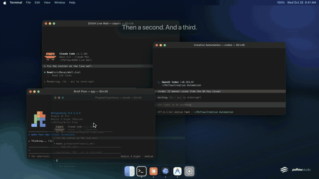
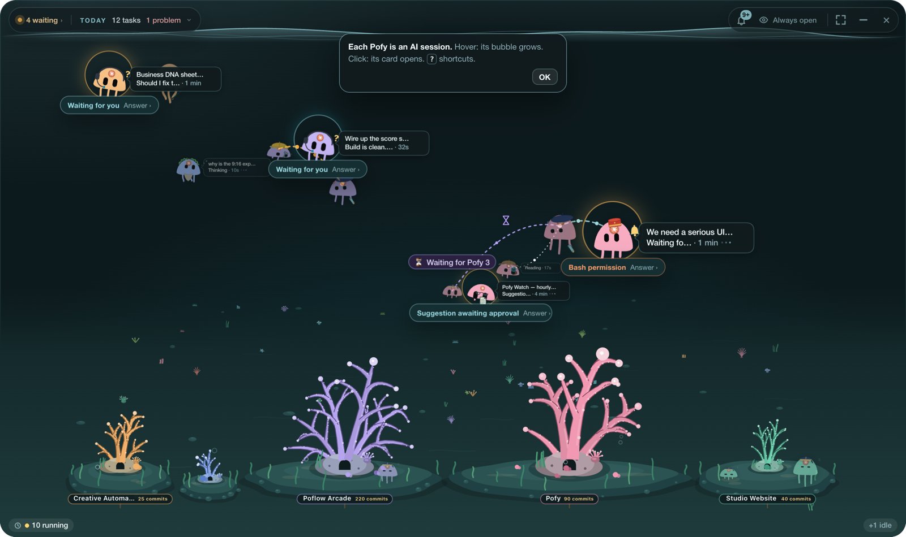
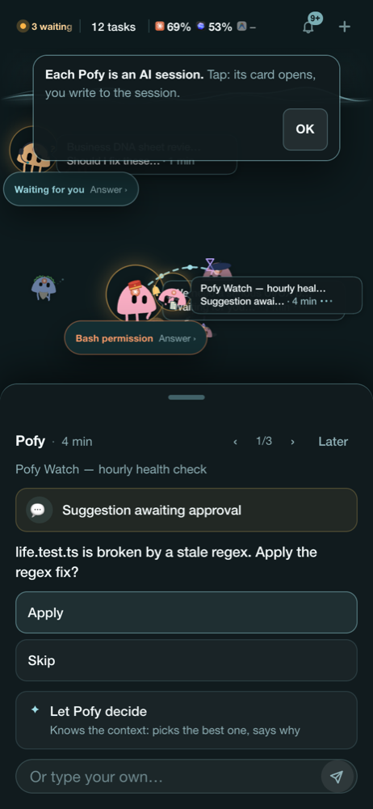
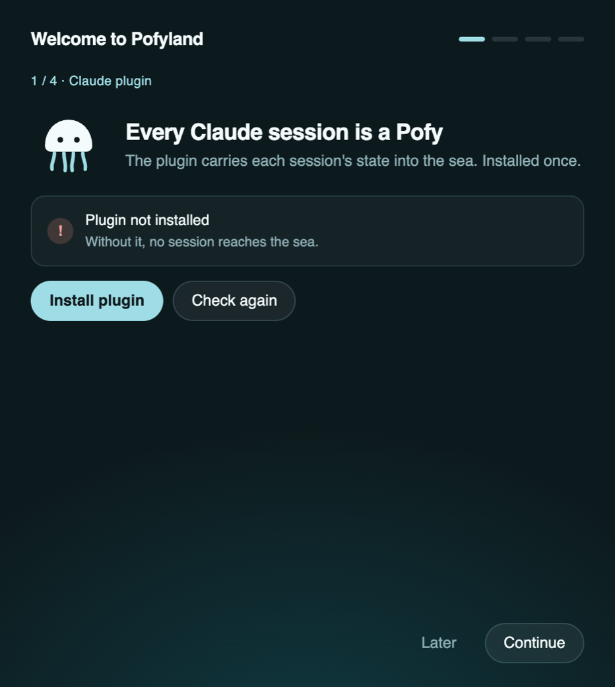
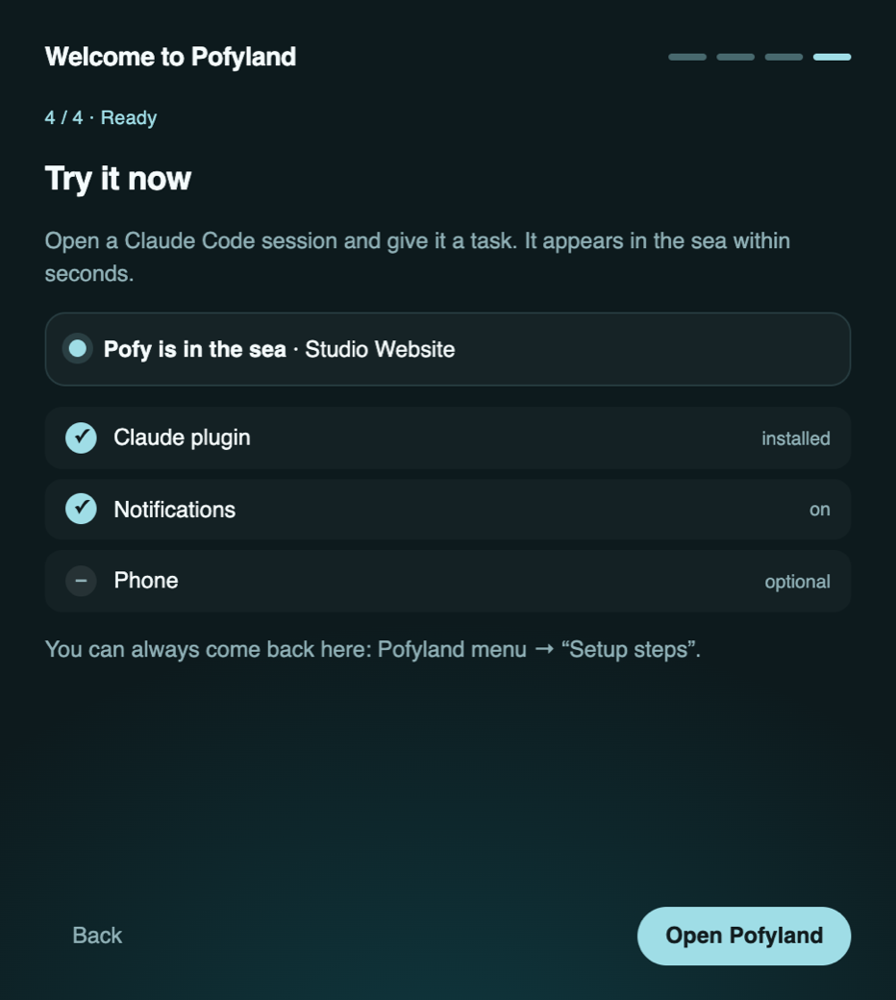

# Pofyland

**A Mac app that shows every running AI coding session as a live jellyfish, all in one sea.**
Each Claude Code session (Codex and Antigravity too) is a "Pofy": the ones working swim, the ones waiting for your permission or
answer come up to the glass and call you, the finished ones settle on the bottom. You see who is doing what and who is waiting
without hopping between windows, and you answer from your Mac or your phone.

[Türkçe](README.tr.md)



## Who it's for

Developers who run several Claude Code sessions in parallel and keep asking "which terminal was that, which one needed my OK".
It helps with a single session too: you get a notification on the Mac and on your phone when Claude is waiting, so work doesn't
stall when you step away.

## What it does

**Status at a glance**
- Every session is a Pofy. Where it is tells you its state: **swimming** means working, **at the glass looking at you** means waiting
  for a permission or an answer, **on the bottom** means idle.
- Its bubble shows the last request and what it's doing ("Thinking · 10 s", "Writing", "Bash permission · 1 min"). Hover and the card grows.
- Every project is an island on the sea floor; its coral grows with the project's commits, and recently active projects come forward.
- If two sessions edit the same file, the bond between them turns red with the file name ("⚠ game.ts").
- The top bar shows how many sessions are waiting for you, what finished today, how many problems, and how much of your Claude / Codex limits is used.



**Answering**
- Permission requests, questions and plan approvals are answered right in Pofyland, no trip to the terminal. You can type a message too.
- When several Pofys are waiting, the cards queue up; ‹ › moves between them.
- "Let Pofy decide" hands the question to Claude, which knows the context, and tells you why.
- Switch the model or the mode (plan, auto) from the card, or stop the session.

**Phone**
- The same sea opens on your phone (add it to the Home Screen from Safari). When a Pofy starts waiting you get a push notification;
  tap it, the card opens, you approve from there. The connection runs over Tailscale and is open only to your own devices.

<p align="center"></p>

**Notifications and the day**
- macOS notifications when a Pofy starts waiting and when a long job ends (with its duration and result). Click to jump to the session.
- A "Today" card: finished jobs, durations, commits, problems. One look in the evening tells you what got done.

**Helpers (optional, they always ask first)**
- Pofyland notices patterns and offers: "commit when the job is done?", "your limit is nearly used up, hand this to Codex?",
  "forward the new comments on your open PR to the Pofy?". Say "always" once and it does it on its own; switch it off in the list of learned rules.
- Proof: when a Pofy edits a page and says "done", and the project's preview server is up, a phone-size and a desktop-size screenshot
  are taken; you judge the picture, not the claim.
- Ulak: connect Gmail and each new mail arrives as a courier that summarizes it and drafts a reply; sending stays your decision.

## How it works

```
Claude Code / Codex / Antigravity sessions
        │  the Claude Code plugin (hooks) writes each session's state
        ▼
Pofyland app (menu bar + sea window + macOS notifications)
        │
        └── Pofyland server, on this Mac only (127.0.0.1:7433)
              → browser, phone (PWA) and phone push (over Tailscale)
```

Everything runs on your Mac. Session summaries, commands and file paths never reach a server; the phone talks to the Mac directly over
Tailscale's encrypted network, to your own devices only. Once a day the app checks this repo for a new version and nothing else.

## Install (one command)

**Requirements:** macOS 13 or newer, Apple Silicon or Intel. [Claude Code](https://claude.com/claude-code) installed
(`claude` works in Terminal; without it Pofyland still installs and you add the plugin later from the menu).

Open Terminal, paste, press Enter:

```sh
curl -fsSL https://raw.githubusercontent.com/konuksev/Pofyland/main/install.sh | sh
```

The script downloads the latest release, copies **Pofyland** into **Applications**, clears the quarantine flag and opens it.
No `sudo`; it only writes to the Applications folder. Under a minute.

**First launch** is a four-step guide:

<p align="center"></p>

1. **Claude plugin:** press "Install plugin". Without it no session reaches the sea. Open Claude sessions appear after a restart, new ones right away.
2. **Notifications:** allow them so you hear when a Pofy is waiting.
3. **Phone:** install [Tailscale](https://tailscale.com) on the Mac and the phone, sign in with the same account, press "Open Pofyland on Tailscale",
   scan the QR code. In Safari, Share → Add to Home Screen gives you notifications too. You can do this later: Pofyland menu → Setup steps.
4. **Ready:** open a Claude Code session and give it a task. The line turns to "Pofy is in the sea" within seconds.

<p align="center"></p>

Then: clicking the Pofy in the menu bar opens and closes the sea; right-click opens the list view (waiting, working, finished).

Options: `POFYLAND_VERSION=v1.0.3` (a specific version), `POFYLAND_DEST=~/Applications`, `POFYLAND_NO_OPEN=1`.

## Manual install

1. From the [latest release](https://github.com/konuksev/Pofyland/releases/latest) download the file for your chip: `Pofyland-…-arm64.dmg` (Apple Silicon)
   or `Pofyland-…-x86_64.dmg` (Intel).
2. Open it and drag **Pofyland** into **Applications**.
3. The app isn't Apple-signed yet, so macOS blocks the first launch: **System Settings → Privacy & Security**, the *"Pofyland was blocked"* row at the
   bottom, **Open Anyway**. Or in Terminal: `xattr -dr com.apple.quarantine /Applications/Pofyland.app`
4. Open it; the first-launch guide is as above.

## Update and uninstall

- Pofyland tells you when a new version is out (it checks here once a day). Pofyland menu → **Update** downloads it, swaps the app and reopens it; the Claude plugin is refreshed on the next launch. Running the install command again works too.
- To remove it: Pofyland menu → **Uninstall**. Removes the app, the background server and the Claude plugin; the keys and settings too if you choose.

## No Pofy showing up? Diagnose

You opened a Claude, Codex or Antigravity session but the sea stays empty. Paste this into Terminal on that Mac:

```sh
curl -fsSL https://raw.githubusercontent.com/konuksev/Pofyland/main/doctor.sh | sh
```

It changes nothing; it checks the app, the background server, the Claude plugin and the Codex / Antigravity commands and prints ✓ / ✗.
The most common cause is the Claude plugin not being installed ("Install plugin" skipped in the guide, or `claude` missing). To repair:

```sh
curl -fsSL https://raw.githubusercontent.com/konuksev/Pofyland/main/doctor.sh | sh -s -- --fix
```

After the plugin is installed, restart open Claude sessions and the Claude app; new sessions come into the sea.
Still stuck? Paste the output into an [issue](https://github.com/konuksev/Pofyland/issues).

## FAQ

**No Pofy appears.** Is the plugin installed: Pofyland menu → Setup steps → "Claude plugin". Sessions that were already open need a restart after the install.

**The phone says "Can't reach the Mac".** Usually the Mac with its lid closed went to sleep. Keep it on power and stop it sleeping with the lid closed
(System Settings → Battery → Options, or the power setting in Pofyland's Setup steps). Tailscale must be on for both devices.

**Where does my data go?** Nowhere. The server listens on 127.0.0.1 only; the phone connects straight to the Mac over Tailscale. Keys live under
`~/Library/Application Support/PofyAqua`, readable only by your account.

**Do Codex and Antigravity show up too?** Yes, their bridges ship with the app; when those apps are running their sessions come into the sea as well.

## Issues and ideas

This repo holds the downloadable releases and the install scripts; the source lives in a separate repo.
Found a problem or have an idea? Open an [issue](https://github.com/konuksev/Pofyland/issues).
