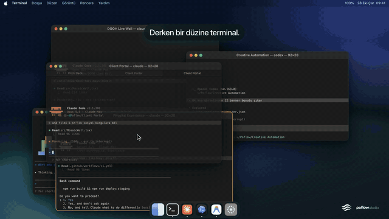
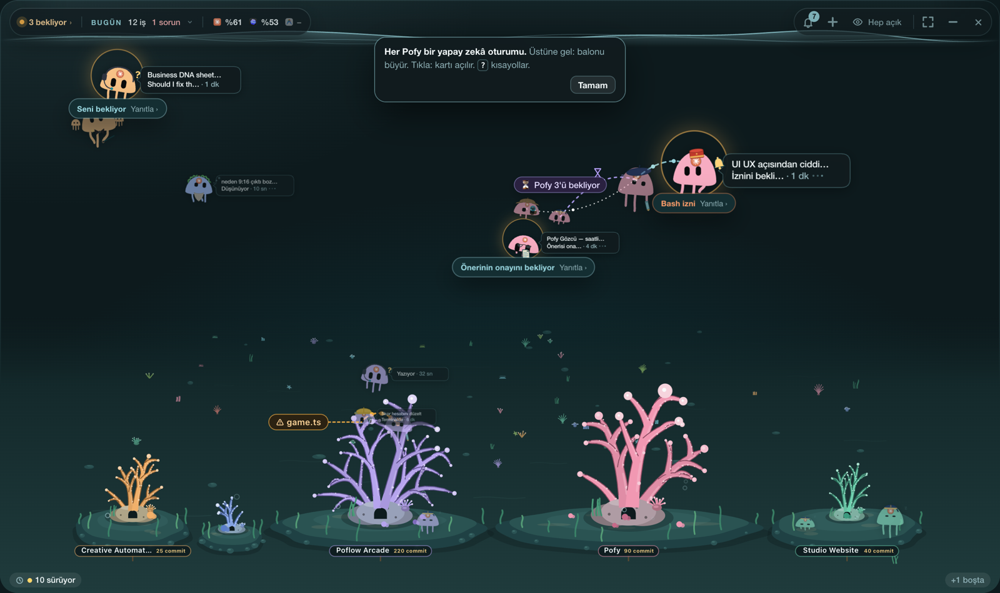
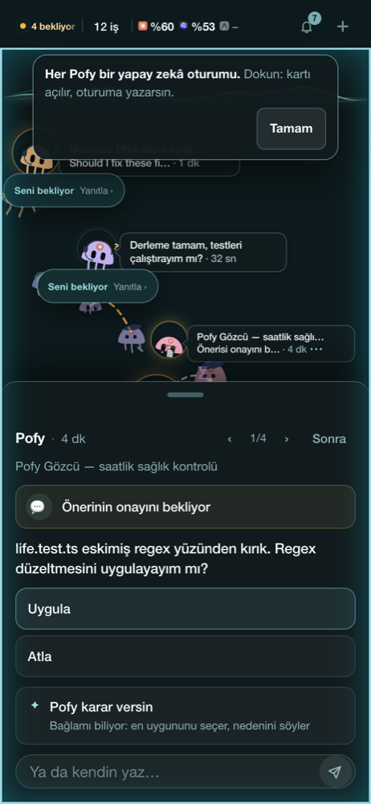

# Pofyland

**Aynı anda çalışan yapay zekâ kodlama oturumlarını tek ekranda, canlı denizanaları olarak gösteren Mac uygulaması.**
Claude Code (ayrıca Codex ve Antigravity) oturumlarının her biri bir "Pofy"dir: çalışan yüzer, senden izin ya da cevap bekleyen
cama gelip seslenir, işi biten dibe iner. Pencereler arasında dolaşmadan kimin ne yaptığını ve kimin seni beklediğini bir bakışta
görürsün; bekleyene Mac'ten ya da telefonundan cevap verirsin.

[English](README.md) · [Telegram topluluğu](https://t.me/+nYWyvW484xxmYjBk)



## Kimin için

Birden fazla Claude Code oturumunu paralel yürüten, bu yüzden sürekli "hangi terminal neredeydi, hangisi izin bekliyordu" diye
dolaşan geliştiriciler için. Tek oturumla çalışıyorsan da işe yarar: Claude seni beklerken Mac'in köşesinde ve telefonunda bildirim
alırsın, masadan kalkınca iş durmaz.

## Ne yapar

**Tek bakışta durum**
- Her oturum bir Pofy. Konumu durumunu söyler: **yüzen** çalışıyor, **camda sana bakan** izin ya da cevap bekliyor, **dipteki** boşta.
- Balonunda son isteği ve ne yaptığı yazar ("Düşünüyor · 10 sn", "Yazıyor", "Bash izni bekliyor · 1 dk"). Üstüne gelince kart büyür.
- Her proje dipte kendi adasıdır; adadaki mercan projenin commit sayısıyla büyür, yakında çalışılan proje öne gelir.
- İki oturum aynı dosyayı düzenliyorsa aralarındaki bağ kırmızıya döner ve dosya adı yazar ("⚠ game.ts").
- Üst çubukta kaç oturum seni bekliyor, bugün kaç iş bitti, kaç sorun var ve Claude / Codex limitlerinin yüzde kaçı kullanıldı.



**Bekleyene cevap**
- İzin isteklerine, sorulara ve plan onaylarına Pofyland'dan cevap verirsin; terminale gitmen gerekmez. Mesaj da yazabilirsin.
- Birden çok Pofy beklerken kartlar sıraya girer; ‹ › ile geçersin.
- "Pofy karar versin" seçeneği soruyu bağlamı bilen Claude'a bırakır ve nedenini söyler.
- Modeli ve kipi (plan, otomatik) karttan değiştirir, oturumu durdurursun.

**Telefon**
- Aynı deniz telefonda da açılır (Safari'de "Ana Ekrana Ekle" ile uygulama gibi). Bir Pofy seni beklemeye başlayınca telefona
  bildirim gelir; dokununca kart açılır, oradan izin verirsin. Bağlantı Tailscale üzerinden yalnızca senin cihazlarına açıktır.

<p align="center"></p>

**Bildirimler ve günün özeti**
- macOS bildirimi: bir Pofy seni beklemeye başlayınca ve uzun bir iş bitince (süresi ve sonucuyla). Tıklayınca o oturuma gider.
- "Bugün" kartı: biten işler, süreler, commit'ler, sorunlar. Akşam tek bakışta ne yapıldığını görürsün.

**Yardımcılar (isteğe bağlı, hepsi önce sorar)**
- Pofyland örüntü görünce önerir: "iş bitince commit atayım mı", "limit dolmak üzere, bu işi Codex'e vereyim mi", "açık PR'ındaki yeni yorumları
  Pofy'ye ileteyim mi". Bir kez "hep yap" dersen sonra kendisi yapar; Öğrendiklerim listesinden kapatırsın.
- Kanıt: Pofy bir sayfayı düzenleyip "bitti" deyince ve projenin önizleme sunucusu açıksa telefon ve masaüstü boyunda ekran görüntüsü alınır;
  sözüne değil görüntüye bakarsın.
- Ulak: Gmail bağlarsan gelen kutuna düşen mail bir Ulak olarak gelir, özetler, yanıt taslağı önerir; gönderme kararı sende.

## Nasıl çalışır

```
Claude Code / Codex / Antigravity oturumları
        │  Claude Code eklentisi (hook'lar) her oturumun durumunu yazar
        ▼
Pofyland uygulaması (menü çubuğu + deniz penceresi + macOS bildirimleri)
        │
        └── Pofyland sunucusu, yalnızca bu Mac'te (127.0.0.1:7433)
              → tarayıcı, telefon (PWA) ve telefona bildirim (Tailscale üzerinden)
```

Her şey senin Mac'inde çalışır. Oturum özetleri, komutlar ve dosya yolları hiçbir sunucuya gitmez; telefon bağlantısı Tailscale'in
kendi şifreli ağı üzerinden yalnızca senin cihazlarınadır. Uygulama günde bir kez yalnızca bu depoya bakıp yeni sürüm var mı diye sorar.

## Kurulum (tek komut)

**Gerekenler:** macOS 13 ve üstü, Apple Silicon ya da Intel. [Claude Code](https://claude.com/claude-code) kurulu olmalı
(Terminal'de `claude` çalışıyor olmalı; yoksa Pofyland yine kurulur, eklentiyi sonra menüden kurarsın).

Terminal'i aç, şunu yapıştır, Enter'a bas:

```sh
curl -fsSL https://raw.githubusercontent.com/konuksev/Pofyland/main/install.sh | sh
```

Betik en son sürümün dmg'sini indirir, **Pofyland**'ı **Applications**'a kopyalar, karantina damgasını kaldırır ve açar.
`sudo` istemez, yalnızca uygulama klasörüne yazar. Bir dakikadan kısa sürer.

**İlk açılış** üç adımlık bir sihirbazdır:
1. **Bildirimler:** izin ver ki bir Pofy seni beklerken haber gelsin.
2. **Claude eklentisi:** "Eklentiyi kur"a bas. Açık Claude oturumların yeniden başlayınca denize gelir, yenileri hemen görünür.
3. **Telefon:** Mac'e ve telefona [Tailscale](https://tailscale.com) kur, aynı hesapla gir, "Tailscale'e aç"a bas, çıkan QR'ı telefonla okut.
   Safari'de Paylaş → Ana Ekrana Ekle dersen bildirimler de gelir. Bu adımı sonra da yapabilirsin: Pofyland menüsü → Kurulum adımları.

Sonra bir Claude Code oturumu aç ve ona bir iş ver: ilk Pofy denize gelir. Menü çubuğundaki Pofy'ye tıklamak denizi açar / kapatır;
sağ tık liste görünümünü (bekleyenler, çalışanlar, bitenler) açar.

Seçenekler: `POFYLAND_VERSION=v1.0.1` (belirli sürüm), `POFYLAND_DEST=~/Applications`, `POFYLAND_NO_OPEN=1`.

## Elle kurulum

1. [Son sürümden](https://github.com/konuksev/Pofyland/releases/latest) işlemcine uygun dosyayı indir: `Pofyland-…-arm64.dmg` (Apple Silicon)
   ya da `Pofyland-…-x86_64.dmg` (Intel).
2. Aç, **Pofyland**'ı **Applications** klasörüne sürükle.
3. Uygulama henüz Apple imzalı değil, ilk açılışta macOS engeller: **Sistem Ayarları → Gizlilik ve Güvenlik**, en alttaki
   *"Pofyland engellendi"* satırında **Yine de Aç**. Ya da Terminal'de: `xattr -dr com.apple.quarantine /Applications/Pofyland.app`
4. Aç; ilk açılış sihirbazı yukarıdaki gibi.

## Güncelleme ve kaldırma

- Yeni sürüm çıkınca Pofyland bildirir (günde bir kez buraya bakar). Pofyland menüsü → **Güncelle** indirir, uygulamayı değiştirir ve yeniden açar; Claude eklentisi bir sonraki açılışta kendiliğinden yenilenir. Kurulum komutunu yeniden çalıştırmak da olur.
- Kaldırmak için Pofyland menüsü → **Kaldır**. Uygulamayı, arka plan sunucusunu ve Claude eklentisini kaldırır; istersen anahtarları ve ayarları da.

## Pofy gelmiyor? Tanı

Claude, Codex ya da Antigravity oturumu açtın ama denizde Pofy yoksa, o Mac'te Terminal'e şunu yapıştır:

```sh
curl -fsSL https://raw.githubusercontent.com/konuksev/Pofyland/main/doctor.sh | sh
```

Hiçbir şeyi değiştirmez; uygulamayı, arka plan sunucusunu, Claude eklentisini ve Codex / Antigravity komutlarını denetler, ✓ / ✗ ile yazar.
En sık neden Claude eklentisinin kurulmamış olmasıdır (sihirbazda "Eklentiyi kur" atlanmış ya da `claude` komutu yokmuş). Eksikse onarmak için:

```sh
curl -fsSL https://raw.githubusercontent.com/konuksev/Pofyland/main/doctor.sh | sh -s -- --fix
```

Eklenti kurulduktan sonra açık Claude oturumlarını ve Claude uygulamasını kapatıp yeniden aç; yeni oturumlar denize gelir.
Çözülmezse çıktıyı olduğu gibi [Issue](https://github.com/konuksev/Pofyland/issues) olarak gönder.

## Sık sorulanlar

**Pofy denize gelmiyor.** Eklenti kurulu mu: Pofyland menüsü → Kurulum adımları → "Claude eklentisi". Eklenti kurulduktan sonra açık
oturumları yeniden başlatmak gerekir.

**Telefondan "Mac'e ulaşılamıyor" diyor.** Çoğu zaman kapağı kapalı Mac uykuya dalmıştır. Mac'i fişe takıp kapağı kapalıyken uyumasını
kapat (Sistem Ayarları → Pil → Seçenekler, ya da Pofyland'ın Kurulum adımlarındaki güç ayarı). Tailscale iki cihazda da açık olmalı.

**Verilerim nereye gidiyor?** Hiçbir yere. Sunucu yalnızca 127.0.0.1 dinler, telefon Tailscale ile doğrudan Mac'e bağlanır. Anahtarlar
`~/Library/Application Support/PofyAqua` altında, yalnızca senin hesabının okuyabileceği izinlerle durur.

**Codex ve Antigravity de görünür mü?** Evet, köprüleri uygulamayla gelir; o uygulamalar açıksa oturumları da denize gelir.

## Sorun / öneri

Bu depo yalnızca indirilecek sürümleri ve kurulum betiğini tutar; kaynak kod ayrı bir depodadır.
Bir sorun bulduysan [hata bildirimi](https://github.com/konuksev/Pofyland/issues/new?template=bug_report.yml) aç.
Diğer kullanıcılarla sohbet, hızlı yardım ve yeni sürüm duyuruları için [Telegram grubuna](https://t.me/+nYWyvW484xxmYjBk) katıl.
Fikir ya da soru için [Discussions](https://github.com/konuksev/Pofyland/discussions)'ta konu başlat; planlananlar
[yol haritasında](https://github.com/users/konuksev/projects). Nasıl yardım edilir: [CONTRIBUTING.md](CONTRIBUTING.md). Güvenlik sorunları: [SECURITY.md](SECURITY.md).

## Lisans

Bu depodaki betikler ve belgeler [MIT Lisansı](LICENSE) altındadır. Pofyland uygulaması, adı ve Pofy karakteri bu lisansın kapsamında değildir.
